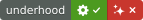

# underhood

A README badge that says whether a project runs deterministic code, model inference, or both.

- ⚙ **mech**: deterministic code (Software 1.0)
- ✨ **magic**: inference from a trained model (Software 2.0 / 3.0)

Each item can be:

- ✓ (required)
- ~ (optional)
- ✗ (absent)

See [SPEC.md](SPEC.md) for the definitions and [the landing page](https://underhood-badge.netlify.app) for the explanation the badge links to.

## Layout

- `src/badge.js`: renders the badge SVG for a level and icon
- `src/build.js`: writes `site/badges/*.svg` (`npm run build`)
- `site/`: the published site (landing page, badges, `icons.html` icon comparison)

## Hosting

Netlify builds `main` and publishes `site/` (see `netlify.toml`) at https://underhood-badge.netlify.app. Badge URLs in other READMEs point there; this README loads its own badge from the repo.
